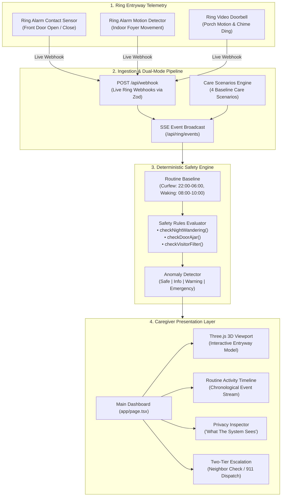

# Architecture & Codebase Structure

This document details the architecture, directory structure, and component layout of Darly.

---

## System Architecture Diagram



---

## Directory Structure

```
darly/
├── src/
│   ├── app/
│   │   ├── api/
│   │   │   ├── ring/
│   │   │   │   ├── analytics/      # GET: Aggregated routine metrics and anomaly analysis
│   │   │   │   ├── config/         # GET/POST: Routine baseline thresholds (curfew, door-ajar limit)
│   │   │   │   ├── devices/        # GET: Connected Ring entryway devices and telemetry
│   │   │   │   ├── events/         # GET: Sensor activity event stream
│   │   │   │   └── token/          # GET/POST: Ring API authentication token handler
│   │   │   └── webhook/
│   │   │       ├── route.ts        # POST: Ingests & validates Ring JSON:API webhook payloads
│   │   │       └── test/route.ts   # GET: Test harness for injecting test sensor events
│   │   ├── layout.tsx              # Root HTML wrapper and metadata
│   │   └── page.tsx                # Main caregiver dashboard container
│   ├── components/
│   │   ├── CameraFocusDock.tsx     # 3D viewport angle shortcuts (front door, porch, foyer)
│   │   ├── CareScenariosPanel.tsx  # Scenario selector and caregiver diagnostic insights
│   │   ├── ChimeModal.tsx          # Resident check-in chime modal with Web Audio feedback
│   │   ├── CloudElements.tsx       # Real-time Ring cloud connection & API health pills
│   │   ├── DeviceSpecCards.tsx     # Ring hardware cards with specs & official doc links
│   │   ├── EmergencyModal.tsx      # Two-tier emergency escalation modal (neighbor / 911 dispatch)
│   │   ├── EntrywayBadge.tsx       # Live status badge for the entryway perimeter
│   │   ├── FloorplanView.tsx       # Interactive 3D and 2D floorplan canvas manager
│   │   ├── Footer.tsx              # Application footer with version and safety disclaimer
│   │   ├── Header.tsx              # Application header with live clock and scenario switch
│   │   ├── House3DView.tsx         # Three.js interactive 3D entryway model with door/bell/motion meshes
│   │   ├── PrivacyInspector.tsx    # "What The System Sees" dual-payload inspection view
│   │   ├── QuickControlsOverlay.tsx# Floating physical device controls for rapid scenario testing
│   │   ├── ResidentInfoBar.tsx     # Care recipient overview banner (name, age, address, contact)
│   │   ├── RoutineTimeline.tsx     # Chronological daily sensor activity stream
│   │   ├── SensorGrid.tsx          # Ring devices telemetry grid with filters and reset trigger
│   │   └── SettingsModal.tsx       # Baseline routine schedules and emergency contact editor
│   ├── lib/
│   │   ├── constants/
│   │   │   └── ringDocs.ts         # Official Ring product & support documentation links
│   │   ├── engine/
│   │   │   ├── anomaly-detector.ts # Sensor event sequence analysis & anomaly aggregation
│   │   │   ├── routine-baseline.ts # Schedule windows, curfew times, and safety thresholds
│   │   │   ├── rules.ts            # Deterministic classification rules (night wandering, courier)
│   │   │   └── types.ts            # Alert levels (Safe, Info, Warning, Emergency) & evaluation types
│   │   ├── schemas/
│   │   │   └── webhook.ts          # Zod validation schemas for incoming Ring webhook events
│   │   ├── types/
│   │   │   ├── devices.ts          # RingEntrywayDevice and SensorEventLog interfaces
│   │   │   ├── profile.ts          # ResidentProfile and emergency contact interfaces
│   │   │   └── webhook.ts          # Amazon Ring JSON:API webhook data structures
│   │   ├── auth.ts                 # Ring OAuth and access token authentication handler
│   │   ├── mock-data.ts            # Default devices, resident profile, and seed events
│   │   ├── scenarios.ts            # 4 pre-configured test scenarios (Safe, Emergency, Warning, Info)
│   │   └── sse-broadcast.ts        # Server-Sent Events hub for live real-time updates
│   └── utils/
│       ├── audioChime.ts           # Web Audio API synthesizer for ambient doorbell & phone chimes
│       └── timelineUtils.tsx       # Timeline formatting, badge colors, and Lucide icon mappers
├── public/                         # Static assets and icons
├── LICENSE                         # Apache License 2.0
├── package.json
└── tsconfig.json
```

---

## Architectural Layers

### 1. Ingestion Layer (`/api/webhook` & `/api/webhook/test`)
- **Transport Standard:** Conforms to Amazon Ring's JSON:API webhook format.
- **Validation:** Every incoming payload is validated at runtime using Zod schemas (`src/lib/schemas/webhook.ts`).
- **Event Broadcasting:** Validated events are stored in-memory and fanned out via Server-Sent Events (`src/lib/sse-broadcast.ts`) to active dashboard clients.

### 2. Decision Engine (`src/lib/engine/`)
- **`routine-baseline.ts`:** Manages baseline schedule configuration (active daytime window, night curfew window, maximum allowable door-ajar duration).
- **`rules.ts`:** Pure, deterministic rule evaluators:
  - `checkNightWandering`: Flags exterior door openings during night curfew hours.
  - `checkDoorAjar`: Flags door contact states that remain open past the allowed threshold.
  - `checkVisitorFilter`: Correlates doorbell dings and porch motion with closed interior doors to classify benign courier visits.
- **`anomaly-detector.ts`:** Evaluates event sequences against the baseline and assigns one of four severity levels:
  - `safe` (All clear, normal routine)
  - `info` (Benign event, courier delivery filtered)
  - `warning` (Routine deviation, missed morning activity)
  - `emergency` (Night wandering or unclosed exterior door)

### 3. Presentation & Interaction Layer (`src/components/`)
- **3D House View (`House3DView.tsx`):** Rendered with Three.js. Provides real-time visual feedback for door open/close animations, doorbell ringing states, and motion detection halos.
- **Privacy Inspector (`PrivacyInspector.tsx`):** Displays side-by-side payloads demonstrating that no audio or video streams enter the home.
- **Audio Synthesizer (`src/utils/audioChime.ts`):** Synthesizes ambient chimes and telephone audio procedurally through the Web Audio API without external audio file dependencies.
