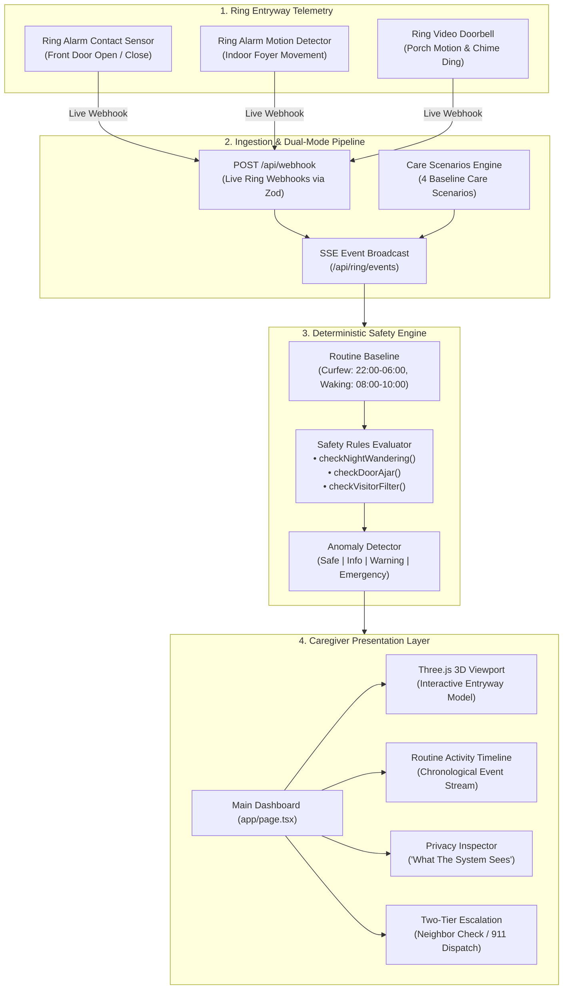

# Architecture & Codebase Structure

This document details the architecture, directory structure, and component layout of Darly.

---

## System Architecture Diagram



---

## Directory Structure

```
darly/
├── src/
│   ├── app/
│   │   ├── api/
│   │   │   ├── ring/
│   │   │   │   ├── analytics/      # Routine metrics and anomalies
│   │   │   │   ├── config/         # Baseline safety thresholds
│   │   │   │   ├── devices/        # Connected Ring devices
│   │   │   │   ├── events/         # Sensor event stream
│   │   │   │   └── token/          # Ring token management
│   │   │   └── webhook/
│   │   │       ├── route.ts        # Ingests Ring webhooks
│   │   │       └── test/route.ts   # Test webhook injector
│   │   ├── layout.tsx              # Root layout and metadata
│   │   └── page.tsx                # Main caregiver dashboard
│   ├── components/
│   │   ├── CameraFocusDock.tsx     # 3D camera controls
│   │   ├── CareScenariosPanel.tsx  # Scenario selector panel
│   │   ├── ChimeModal.tsx          # Resident check-in modal
│   │   ├── CloudElements.tsx       # Cloud status pills
│   │   ├── DeviceSpecCards.tsx     # Hardware spec cards
│   │   ├── EmergencyModal.tsx      # Emergency escalation modal
│   │   ├── EntrywayBadge.tsx       # Entryway status badge
│   │   ├── FloorplanView.tsx       # 3D entryway view
│   │   ├── Footer.tsx              # Application footer
│   │   ├── Header.tsx              # Header with controls
│   │   ├── House3DView.tsx         # Three.js 3D model
│   │   ├── PrivacyInspector.tsx    # Privacy telemetry inspector
│   │   ├── QuickControlsOverlay.tsx# Device quick controls
│   │   ├── ResidentInfoBar.tsx     # Resident info banner
│   │   ├── RoutineTimeline.tsx     # Daily activity timeline
│   │   ├── SensorGrid.tsx          # Device telemetry grid
│   │   └── SettingsModal.tsx       # Routine settings modal
│   ├── lib/
│   │   ├── constants/
│   │   │   └── ringDocs.ts         # Ring documentation links
│   │   ├── engine/
│   │   │   ├── anomaly-detector.ts # Routine anomaly detector
│   │   │   ├── routine-baseline.ts # Baseline schedule config
│   │   │   ├── rules.ts            # Safety classification rules
│   │   │   └── types.ts            # Safety engine types
│   │   ├── schemas/
│   │   │   └── webhook.ts          # Zod webhook schemas
│   │   ├── types/
│   │   │   ├── devices.ts          # Device data types
│   │   │   ├── profile.ts          # Resident profile types
│   │   │   └── webhook.ts          # Ring webhook types
│   │   ├── auth.ts                 # Ring token auth
│   │   ├── mock-data.ts            # Default seed data
│   │   ├── scenarios.ts            # 4 care scenarios
│   │   └── sse-broadcast.ts        # Real-time SSE hub
│   └── utils/
│       ├── audioChime.ts           # Web Audio synthesizer
│       └── timelineUtils.tsx       # Timeline display helpers
├── public/                         # Static assets and icons
├── LICENSE                         # Apache License 2.0
├── package.json
└── tsconfig.json
```

---

## Architectural Layers

### 1. Ingestion Layer (`/api/webhook` & `/api/webhook/test`)
- **Transport Standard:** Conforms to Amazon Ring's JSON:API webhook format.
- **Validation:** Every incoming payload is validated at runtime using Zod schemas (`src/lib/schemas/webhook.ts`).
- **Event Broadcasting:** Validated events are stored in-memory and fanned out via Server-Sent Events (`src/lib/sse-broadcast.ts`) to active dashboard clients.

### 2. Decision Engine (`src/lib/engine/`)
- **`routine-baseline.ts`:** Manages baseline schedule configuration (active daytime window, night curfew window, maximum allowable door-ajar duration).
- **`rules.ts`:** Pure, deterministic rule evaluators:
  - `checkNightWandering`: Flags exterior door openings during night curfew hours.
  - `checkDoorAjar`: Flags door contact states that remain open past the allowed threshold.
  - `checkVisitorFilter`: Correlates doorbell dings and porch motion with closed interior doors to classify benign courier visits.
- **`anomaly-detector.ts`:** Evaluates event sequences against the baseline and assigns one of four severity levels:
  - `safe` (All clear, normal routine)
  - `info` (Benign event, courier delivery filtered)
  - `warning` (Routine deviation, missed morning activity)
  - `emergency` (Night wandering or unclosed exterior door)

### 3. Presentation & Interaction Layer (`src/components/`)
- **3D House View (`House3DView.tsx`):** Rendered with Three.js. Provides real-time visual feedback for door open/close animations, doorbell ringing states, and motion detection halos.
- **Privacy Inspector (`PrivacyInspector.tsx`):** Displays side-by-side payloads demonstrating that no audio or video streams enter the home.
- **Audio Synthesizer (`src/utils/audioChime.ts`):** Synthesizes ambient chimes and telephone audio procedurally through the Web Audio API without external audio file dependencies.
